# Heavy Machinery & Logistics Rental Aggregator — Dink Machinery
## System Application Flow Diagrams & Architecture Choreography (`docs/source/Heavy_Machinery_App_Flow_Diagrams.md`)

**Document Identifier:** `FLOW-DINK-CORE-V7.0`  
**Classification:** Canonical Architecture & Development Reference (Single Source of Truth)  
**Governing Documents:** `SRS-DINK-CORE-V7.0` (Parts 1–5), `contracts/openapi.yaml`, `docs/components/mobile/DESIGN.md`, `docs/components/mobile/AGENTS.md`  
**Target Runtimes:** Go 1.27.3 Modular Monolith, Flutter 3.44 Cross-Platform Mobile Client, Next.js 16 Admin Web Console, PostgreSQL 18.4 + PostGIS 3.4, Valkey 8.0-alpine, SeaweedFS S3  
**Target Markets:** Ethiopia (`ET`) & Kenya (`KE`) — Dynamic Multi-Country Parameterization (`LOC-01-BE`)  
**Compliance Standards:** OWASP ASVS 4.0.3 Level 3, RFC 9457 (Problem Details), W3C WCAG 2.1/2.2 AA, ISO/IEC/IEEE 29148, ISO 4217, ISO 3166-1 alpha-2  
**Status:** Approved Production Architecture

---

## Table of Contents

1. [High-Level System Context & Multi-Persona Ingress](#1-high-level-system-context--multi-persona-ingress)
2. [Identity, Registration & Pluggable Verification Flows](#2-identity-registration--pluggable-verification-flows)
   - 2.1 [Passwordless Phone OTP Authentication & Refresh Rotation](#21-passwordless-phone-otp-authentication--refresh-rotation)
   - 2.2 [Pluggable Identity Verification (Fayda / National ID Adapter)](#22-pluggable-identity-verification-fayda--national-id-adapter)
   - 2.3 [Multi-Factor Authentication (Passkey WebAuthn & TOTP)](#23-multi-factor-authentication-passkey-webauthn--totp)
3. [Fleet Registration, Dynamic EAV Taxonomy & Availability Scheduling](#3-fleet-registration-dynamic-eav-taxonomy--availability-scheduling)
4. [Geospatial Radius Discovery, Corridor Search & Filtering (PostGIS)](#4-geospatial-radius-discovery-corridor-search--filtering-postgis)
5. [End-to-End Booking Reservation, 60-Minute Valkey Hold & Dual Settlement](#5-end-to-end-booking-reservation-60-minute-valkey-hold--dual-settlement)
   - 5.1 [Manual Direct Transfer Flow (`MANUAL_TRANSFER` / Direct Transfer Model)](#51-manual-direct-transfer-flow-manual_transfer--direct-transfer-model)
   - 5.2 [Online Payment Gateway Flow (`GATEWAY` / Pluggable Adapter)](#52-online-payment-gateway-flow-gateway--pluggable-adapter)
6. [The Canonical 20-State Booking Machine Choreography](#6-the-canonical-20-state-booking-machine-choreography)
7. [Handover Check-In & Check-Out Inspection Workflow (Monotonic Meters & ClamAV)](#7-handover-check-in--check-out-inspection-workflow-monotonic-meters--clamav)
8. [Damage Dispute Arbitration, SLA Escalation & Escrow Settlement](#8-damage-dispute-arbitration-sla-escalation--escrow-settlement)
9. [Logistics Transport Sub-Booking & Bidirectional Cascade Cancellation](#9-logistics-transport-sub-booking--bidirectional-cascade-cancellation)
10. [Double-Entry Financial Ledger & Wallet-Debit Commission Accounting](#10-double-entry-financial-ledger--wallet-debit-commission-accounting)
11. [Operator Dispatch, 30-Second GPS Telematics & Geofence Breach Engine](#11-operator-dispatch-30-second-gps-telematics--geofence-breach-engine)
12. [Server-Driven Dynamic Admin UI Engine (`/api/v1/admin/ui-config`)](#12-server-driven-dynamic-admin-ui-engine-apiv1adminui-config)
13. [Dynamic Multilingual Typography & OTA Font Pipeline (`ADR-013`)](#13-dynamic-multilingual-typography--ota-font-pipeline-adr-013)
14. [Offline-First Resilience, Isar Local Store & Background Sync Engine](#14-offline-first-resilience-isar-local-store--background-sync-engine)

---

## 1. High-Level System Context & Multi-Persona Ingress

The Dink Machinery ecosystem orchestrates interactions across three primary edge personas (Renters, Fleet Owners, Field Operators) on mobile, plus back-office administrative operations on the web console. All traffic terminates at the Traefik 3.x edge ingress, routing to a single compiled Go 1.27.3 modular monolith backend.

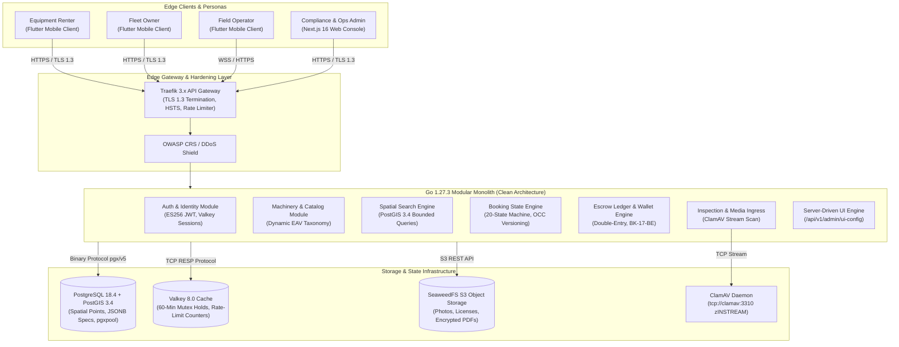

---

## 2. Identity, Registration & Pluggable Verification Flows

### 2.1 Passwordless Phone OTP Authentication & Refresh Rotation

Authentication adheres to OWASP ASVS 4.0.3 Level 3 with single-use rotating refresh tokens stored in Valkey and cryptographic ES256 session JWTs.

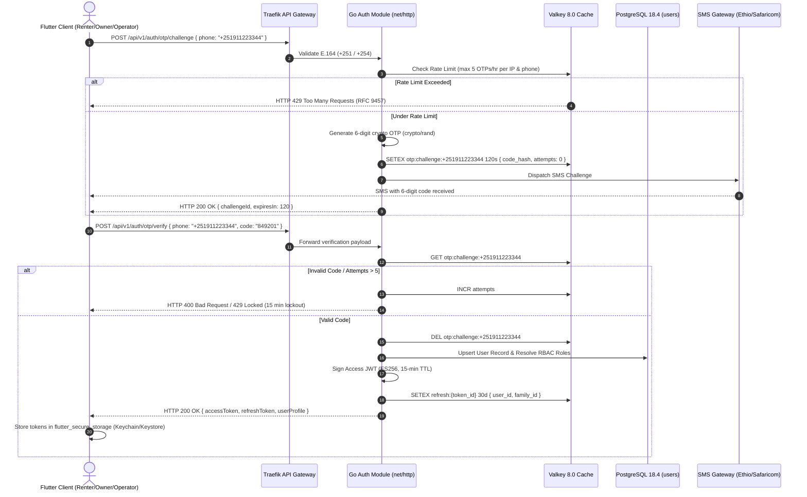

### 2.2 Pluggable Identity Verification (Fayda / National ID Adapter)

Verification uses a provider-agnostic framework (`REG-IDP-01-BE`). When active, missing required identity proofs block mutating transactional APIs (`AUTH-05-BE`).

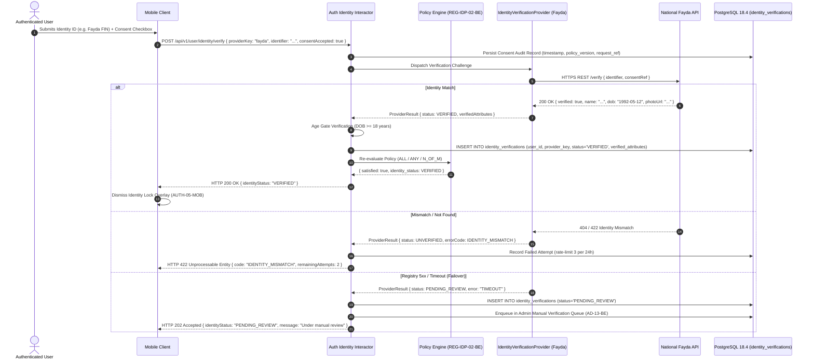

### 2.3 Multi-Factor Authentication (Passkey WebAuthn & TOTP)

Enforces mandatory TOTP setup for administrative staff (`AUTH-04-WEB`) while offering progressive Passkey and Authenticator App options for standard personas.

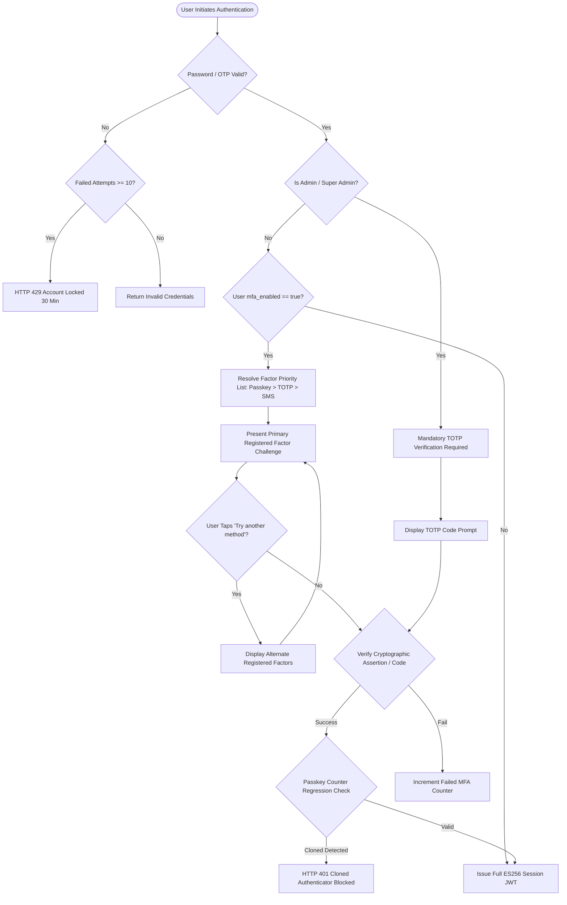

---

## 3. Fleet Registration, Dynamic EAV Taxonomy & Availability Scheduling

Fleet asset registration dynamically validates technical specifications using dynamic JSON Schema attributes stored in `spec_field_definitions` based on the chosen category.

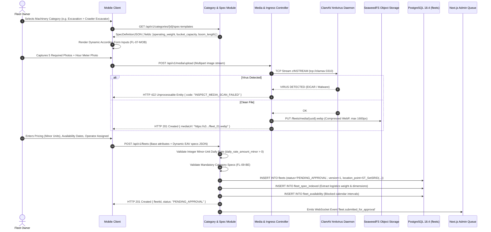

---

## 4. Geospatial Radius Discovery, Corridor Search & Filtering (PostGIS)

Dink Machinery executes high-throughput, low-latency spheroidal distance queries over PostGIS GiST indexes, ensuring queries complete within $\le 80\text{ ms}$ at P95 for up to 1,000,000 assets.

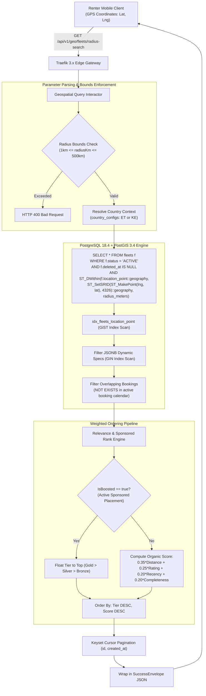

---

## 5. End-to-End Booking Reservation, 60-Minute Valkey Hold & Dual Settlement

### 5.1 Manual Direct Transfer Flow (`MANUAL_TRANSFER` / Direct Transfer Model)

The primary MVP settlement rail where the renter pays the fleet owner directly via commercial bank transfer. The platform holds zero customer escrow funds, collecting marketplace commission via owner wallet debit upon confirmation (`BK-17-BE`).

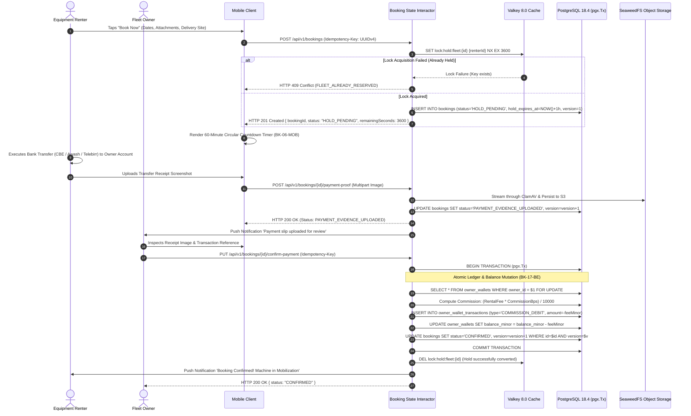

### 5.2 Online Payment Gateway Flow (`GATEWAY` / Pluggable Adapter)

When pluggable online gateways (Telebirr, MPESA) are activated, state machine transitions occur automatically via cryptographic webhook callbacks.

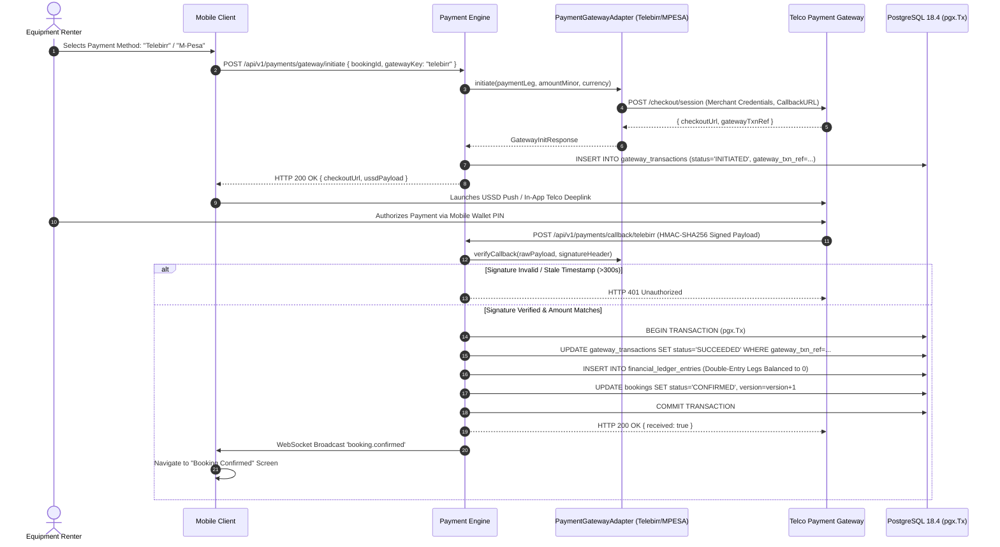

---

## 6. The Canonical 20-State Booking Machine Choreography

The rental booking machine enforces 20 deterministic states, strictly governed by optimistic concurrency control (`WHERE id = $1 AND version = $2`). Arbitrary or unmapped transitions abort immediately with RFC 9457 error `BOOKING_INVALID_STATE_TRANSITION`.

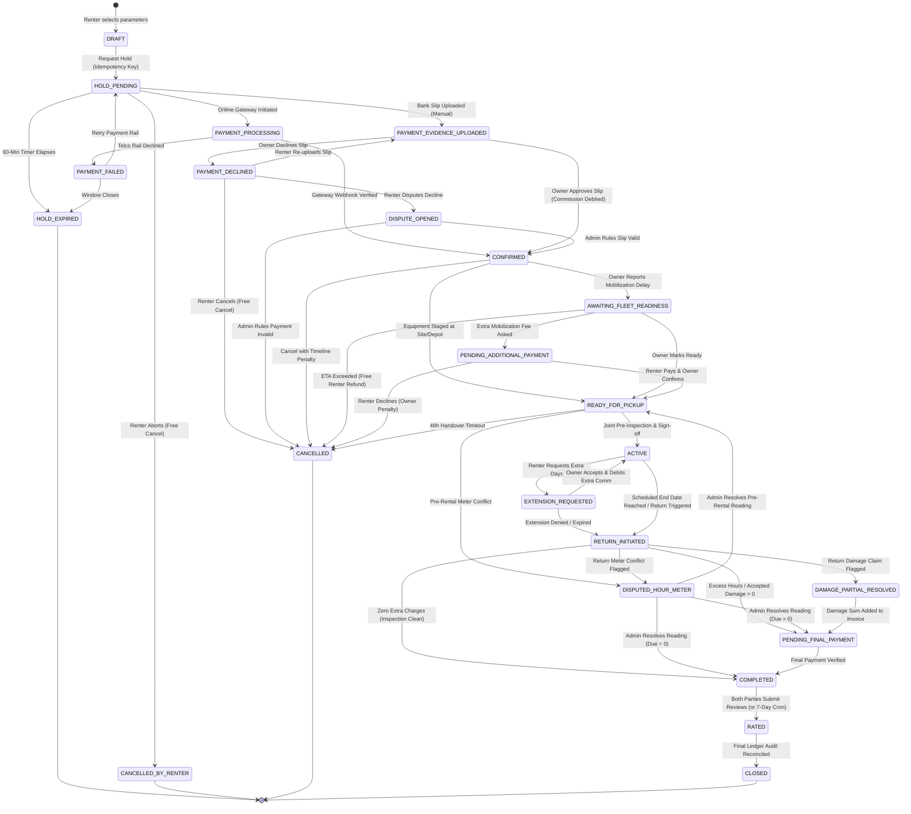

---

## 7. Handover Check-In & Check-Out Inspection Workflow (Monotonic Meters & ClamAV)

Physical equipment handovers require a joint digital inspection enforcing monotonic hour meter progression and real-time antivirus scanning.

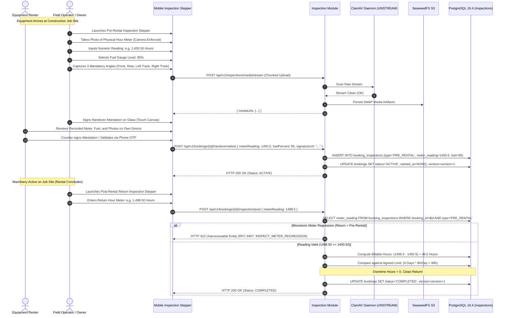

---

## 8. Damage Dispute Arbitration, SLA Escalation & Escrow Settlement

Disputed claims (unmatched damage, hour-meter discrepancies) are isolated into a first-class `Dispute` domain with strict 3-day SLA timers and dual administrative communication channels.

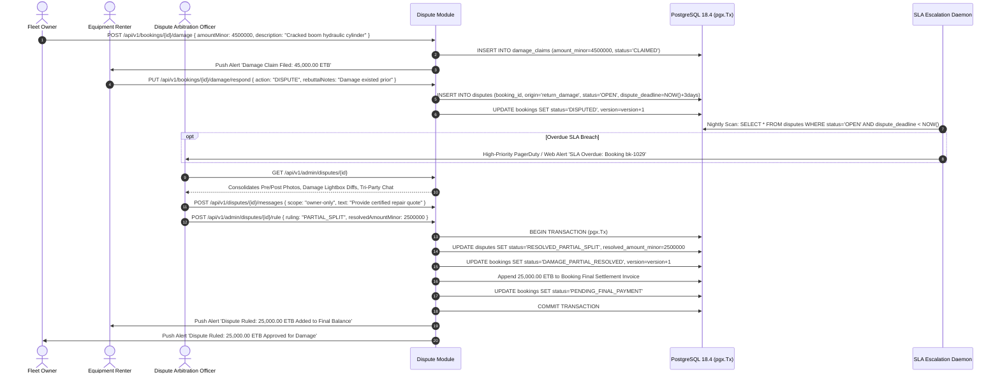

---

## 9. Logistics Transport Sub-Booking & Bidirectional Cascade Cancellation

Logistics transport vehicles (lowboys, flatbeds) are booked as formal sub-bookings linked via `parent_booking_id`. Cancellation cascades preserve operational fairness.

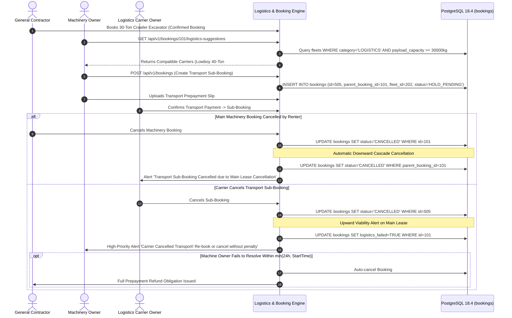

---

## 10. Double-Entry Financial Ledger & Wallet-Debit Commission Accounting

Under requirement `BK-17-BE`, every mutating financial action writes immutable, balanced credit and debit rows into `financial_ledger_entries`. The sum of all legs in a transaction must equal exactly zero minor units.

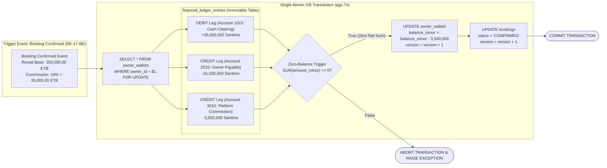

---

## 11. Operator Dispatch, 30-Second GPS Telematics & Geofence Breach Engine

Operating under requirements `GPS-01` to `GPS-04`, the mobile client streams high-precision GPS telematics via WebSocket every 30 seconds when in `ACTIVE` or `IN_TRANSIT` states.

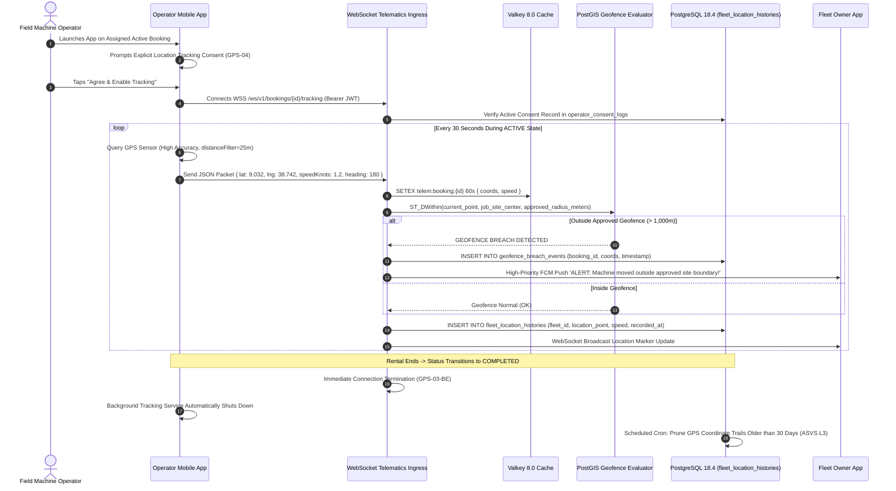

---

## 12. Server-Driven Dynamic Admin UI Engine (`/api/v1/admin/ui-config`)

The Next.js 16 back-office console eliminates hardcoded administrative pages. Menus, data table columns, search filters, and RBAC-gated action buttons are delivered dynamically from `/api/v1/admin/ui-config`.

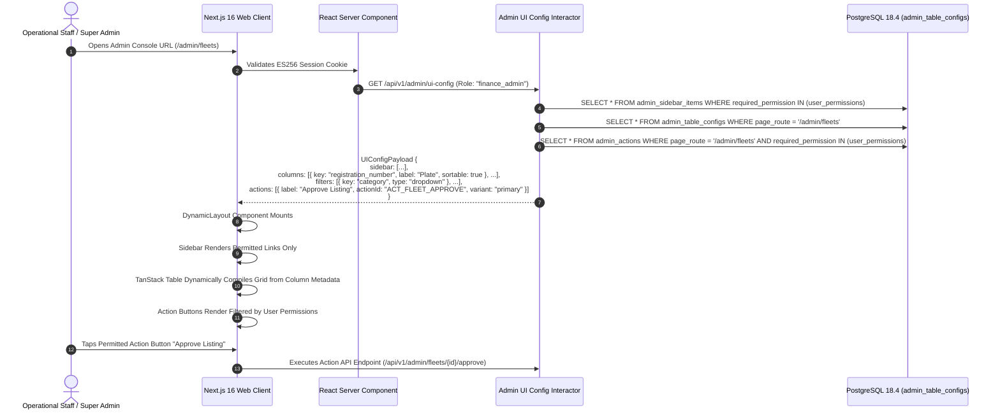

---

## 13. Dynamic Multilingual Typography & OTA Font Pipeline (`ADR-013`)

To guarantee flawless rendering of Ethiopic (`am`, `om`, `ti`) and Arabic scripts without bloating the initial base application binary, non-Latin typography is delivered over-the-air (OTA) with SHA-256 integrity validation.

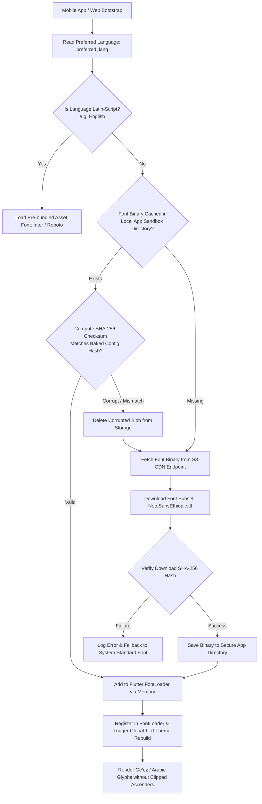

---

## 14. Offline-First Resilience, Isar Local Store & Background Sync Engine

Field inspectors in remote quarries or road construction corridors can record full condition reports offline. Data is isolated in local Isar NoSQL storage and synchronized idempotently upon connection recovery.

```mermaid
flowchart TD
    subgraph OfflineCapture["Offline Field Capture Phase (No Connectivity)"]
        FieldOperator[Field Operator on Remote Site] --> SubmitInsp[Completes Handover Inspection Form]
        SubmitInsp --> NetCheck{Network Available?}
        NetCheck -- Offline --> LocalStore[Write Inspection Draft to Isar DB]
        LocalStore --> GenerateDraftId[Assign UUIDv4 localDraftId]
        GenerateDraftId --> StatusQueued[Set syncStatus = SyncStatus.queued]
        StatusQueued --> CacheMedia[Persist Full-Res Photos in App File Cache]
    end

    subgraph SyncLoop["Connectivity Restoration & Background Sync Daemon"]
        NetListener[connectivity_plus Listener] --> ReconnectEvent[Network Interface Restored: 3G / LTE]
        ReconnectEvent --> SyncEngine[Trigger SyncEngine.processQueue]
        
        SyncEngine --> ReadQueue[Read All Inspections WHERE syncStatus == queued]
        ReadQueue --> CompressIsolate["Background Worker Isolate (compute)<br>Resize Photos to WebP 1600px, Quality 82%"]
        
        CompressIsolate --> StreamMedia["POST /media/upload<br>(Stream Bytes through ClamAV Daemon)"]
        StreamMedia --> S3Urls[Receive S3 Object URLs]
        
        S3Urls --> MutatingRPC["POST /api/v1/inspections/sync<br>(Header: Idempotency-Key == localDraftId)"]
        
        MutatingRPC --> BackendResponse{Backend Response Status}
        BackendResponse -- 200 / 201 Success --> MarkSynced[Update Isar: syncStatus = SyncStatus.synced]
        BackendResponse -- 409 Conflict --> MarkConflict[Update Isar: syncStatus = SyncStatus.failed]
        
        MarkSynced --> PurgeLocal[Purge Temporary File Cache]
        MarkConflict --> PromptOperator[Surface Manual Concurrency Resolution Prompt]
    end
```

---

*This document represents the canonical flow diagram and architectural choreography specification for Dink Machinery Version 7.0. All downstream code generation, sequence verification, and component wiring must strictly mirror the visual and state transitions specified herein.*