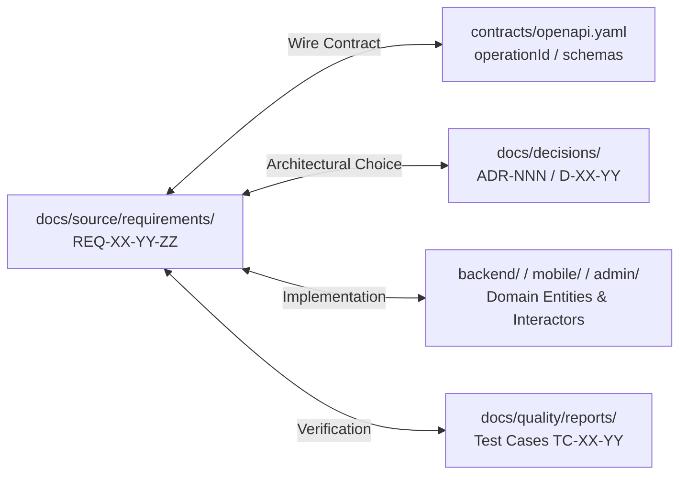

# Canonical Requirements & Specification Source (`docs/source/`) — Dink Machinery

**Directory:** `docs/source/`  
**Classification:** Canonical Single Source of Truth (SSOT) — Architecture & Requirements  
**Target Audience:** AI Agents, System Architects, Domain Engineers & Quality Assurance  
**Governing Documents:** `AGENTS.md`, `TECH_STACK.md`, `CODE_STANDARDS.md`, `API_CONVENTIONS.md`, `ERROR_CATALOG.md`, `DEFINITION_OF_DONE.md`, `docs/AI_TASKS/02-new-requirement.md`  
**Compliance Standards:** ISO/IEC/IEEE 29148 (Requirements Engineering), OWASP ASVS 4.0.3 Level 3, RFC 9457 (Problem Details), ISO 4217, ISO 3166-1 alpha-2

---

## 1. Executive Summary & Purpose

The `docs/source/` directory is the canonical, authoring single source of truth for all functional specifications, non-functional requirements, domain state machines, and business rules governing the **Dink Machinery** platform across Ethiopia (`ET`) and Kenya (`KE`).

Direct application code implementation, database schema migrations, and API contract additions without an approved requirement specification in `docs/source/` are prohibited.

### The Canonical vs. Shared Synchronization Architecture
To avoid divergence between system architecture documentation and partition-level views:
- **Canonical Authoring (`docs/source/`):** All new requirements, functional enhancements, and domain rule updates are authored and edited strictly within `docs/source/requirements/`.
- **Distributed Read-Only Views (`docs/shared/requirements/`):** Downstream partition views are synchronized from `docs/source/` via automated repository scripts (`scripts/sync-docs.sh`). Hand-editing files inside `docs/shared/` is blocked by CI drift detection.

```
                           Requirement Lifecycle & Drift Elimination
                                              │
  [New Requirement Intake]                    ▼
  PROTO-02-NEW-REQUIREMENT        ┌─────────────────────────┐
                                  │      docs/source/       │  Canonical Authoring SSOT
                                  │   (Authoritative SRS)   │  Version-Controlled
                                  └────────────┬────────────┘
                                               │
                                               ├──────────────────────────────────┐
                                               ▼                                  ▼
                                  ┌─────────────────────────┐        ┌─────────────────────────┐
                                  │  contracts/openapi.yaml │        │ docs/shared/requirements│
                                  │   (Wire API Contract)   │        │  (Synchronized Mirror)  │
                                  └────────────┬────────────┘        └─────────────────────────┘
                                               │
                                               ▼
                                  ┌─────────────────────────┐
                                  │  Multi-Tier Scaffolding │  backend/ (Go 1.27.3)
                                  │  & Implementation       │  mobile/  (Flutter 3.47.9)
                                  └─────────────────────────┘  admin/   (Next.js 16)
```

---

## 2. Platform Invariants Enforced in All Specifications

Every functional requirement authored in `docs/source/` must explicitly state its compliance with the seven foundational system invariants:

1. **Contract Supremacy:** Wire models, endpoints, and error responses must map to `contracts/openapi.yaml` passing Spectral linting before implementation starts.
2. **Deterministic Minor-Unit Money:** Floating-point numbers are strictly forbidden. All monetary fields must use 64-bit signed integers (`int64` / `BIGINT`) representing minor currency units (Santims for `ETB`, Cents for `KES` and `USD`) paired with an ISO 4217 currency code (`MoneyAmount`).
3. **In-Transaction Ledger Atomicity (`BK-17-BE`):** Any requirement mutating financial balances or holding escrow must execute state updates and `financial_ledger_entries` inside a single database transaction (`pgx.Tx`), balancing debits and credits to exactly zero minor units.
4. **Optimistic Concurrency Control (OCC):** Stateful entities (`bookings`, `fleets`, `wallets`, `inspections`) must specify `version INT NOT NULL DEFAULT 1` and require OCC mutation semantics (`WHERE id = $1 AND version = $2`).
5. **Soft-Delete Standard (`SD-01-BE`):** Mutable records must specify `deleted_at TIMESTAMPTZ NULL`. Application queries must filter `WHERE deleted_at IS NULL` or target active database views (`v_active_*`).
6. **Multi-Country Parameterization (`LOC-01-BE`):** Hardcoded geographic or regulatory constants are prohibited. Rules (VAT basis points, withholding taxes, currencies, dialing prefixes, hold timeouts) must resolve dynamically from `country_configs`.
7. **OWASP ASVS Level 3 Zero-PII Protection:** Telephone numbers, National IDs, TINs, and financial accounts must be encrypted at rest (AES-256-GCM), masked in structured logs, and omitted from client-facing error envelopes.

---

## 3. Directory Layout & Partition Decomposition

The `docs/source/` directory decomposes the platform into 13 modular functional partitions matching bounded domain contexts:

```
docs/source/
├── README.md                         # This master document
├── GLOSSARY.md                       # Canonical domain glossary and RFC 2119 keyword definitions
└── requirements/                     # Partitioned Software Requirements Specifications
    ├── 05-01-core-identity-auth.md   # Phone OTP, National ID verification, JWT & RBAC
    ├── 05-02-country-configs.md      # Multi-country parameterization (ET/KE tax & currencies)
    ├── 05-03-telematics-gps.md       # Real-time operator GPS tracking & geofencing
    ├── 05-04-machinery-catalog.md    # Fleet asset taxonomy, dynamic EAV specs & attachments
    ├── 05-05-booking-engine.md       # 20-state rental machine, 60-min hold locks & OCC
    ├── 05-06-escrow-ledger.md        # Double-entry ledger, escrow holds, Telebirr/MPESA rails
    ├── 05-07-inspections.md          # Check-in/out inspections, hour meters, ClamAV media ingress
    ├── 05-08-disputes-arbitration.md # Contested deposits, damage lightboxes, admin rulings
    ├── 05-09-operator-dispatch.md    # Machine + operator bundling, job boards, logistics transit
    ├── 05-10-admin-ui-config.md      # Server-driven dynamic metadata engine (/admin/ui-config)
    ├── 05-11-notifications.md       # Real-time push, SMS OTP fallbacks, in-app notification center
    ├── 05-12-wallet-disbursement.md  # Fleet owner wallet balances, payout thresholds & withdrawals
    └── 05-13-insurance-documents.md  # Proof-of-insurance verification, title deeds & PDF ingress
```

---

## 4. Requirement Partition Catalog & Bounded Contexts

| Partition ID | Specification Title | Bounded Context | Core Entities & Subsystems Covered |
|---|---|---|---|
| **`05-01`** | **Core Identity & Authentication** | `modules/auth` | User accounts, phone OTP challenge sessions, National ID / Kebele cards, JWT ES256 tokens, Valkey refresh rotation. |
| **`05-02`** | **Country Configurations (`LOC-01-BE`)** | `modules/admin` | `country_configs`, ISO 3166-1 alpha-2, tax basis points (VAT/WHT bps), currency definitions (ETB, KES, USD). |
| **`05-03`** | **Telematics & GPS Tracking** | `modules/geo` | PostGIS spatial queries, operator GPS location streams ($30\text{s}$ interval), $500\text{m}$ geofencing validation. |
| **`05-04`** | **Machinery Catalog & EAV Specs** | `modules/machinery` | Machinery asset registry, category taxonomies, attachments compatibility, dynamic EAV spec attributes. |
| **`05-05`** | **Booking Engine & State Machine** | `modules/booking` | 20-state lifecycle machine, 60-minute reservation holds, Valkey distributed locks, OCC version increments. |
| **`05-06`** | **Escrow Ledger & Payments (`BK-17-BE`)** | `modules/payment` | Double-entry financial ledger, zero-sum balancing, payment rail webhooks (Telebirr, CBEBirr, MPESA). |
| **`05-07`** | **Site Inspections & Media Ingress** | `modules/inspection`| Check-in/check-out wizard, monotonic hour meters, fuel percentage, ClamAV antivirus stream inspection. |
| **`05-08`** | **Disputes & Arbitration** | `modules/booking` | Contested damage triage, dual-party inspection comparison, deposit forfeiture, admin arbitration rulings. |
| **`05-09`** | **Operator Dispatch & Logistics** | `modules/machinery` | Machine + Operator bundling, transport mobilization surcharges, turn-by-turn job site dispatch routing. |
| **`05-10`** | **Admin Dynamic UI Engine (`AD-06-BE`)**| `modules/admin` | `/api/v1/admin/ui-config`, server-driven tables, dynamic column schemas, RBAC-filtered action buttons. |
| **`05-11`** | **Notifications & Alert Center** | `modules/platform` | Asynchronous push notifications, SMS OTP gateway dispatch, in-app notification registers. |
| **`05-12`** | **Owner Wallet & Disbursements** | `modules/payment` | Available vs. pending wallet balances, bank routing tokens, automated payouts, withholding tax deductions. |
| **`05-13`** | **Insurance & Document Compliance**| `modules/machinery` | Commercial insurance certificates, ownership title deeds, expiration tracking, PDF document ingress. |

---

## 5. Specification Authoring Standard & Syntax

Every specification file under `docs/source/requirements/` must adhere to the standardized structure established in `docs/AI_TASKS/02-new-requirement.md`.

### 5.1. Mandatory Requirement Identifier Syntax
Requirement identifiers must follow the deterministic format:
```text
REQ-<partition_id>-<subsystem_or_topic>-<sequence_number>
```
*Examples:*
- `REQ-05-01-AUTH-01`: Phone OTP challenge initiation.
- `REQ-05-04-CAT-03`: Dynamic EAV specification attribute validation.
- `REQ-05-05-BKG-02`: 60-minute booking hold lock acquisition.
- `REQ-05-06-LED-04`: In-transaction double-entry ledger balance assertion.
- `REQ-05-07-INS-02`: Monotonic operating hours meter regression rejection.

### 5.2. Mandatory Specification Document Sections
Each partition document must contain:
1. **Bounded Context & Objective:** Scope and business purpose.
2. **Functional Requirements Inventory:** Itemized `REQ-*` entries using RFC 2119 keywords (`MUST`, `SHALL`, `SHOULD`).
   - Persona mapping (`RENTER`, `OWNER`, `OPERATOR`, `ADMIN`, `SYSTEM`).
   - Wire contract mapping (`[HTTP_METHOD] /api/v1/...` and `operationId`).
   - Persistence invariants (Table name, OCC `version`, soft-delete filter, minor-unit money).
3. **Non-Functional & Security Constraints (ASVS Level 3):** PII masking rules, encryption, rate limits.
4. **Architectural Decision Tracing:** Bidirectional links to governing L1 ADRs (`ADR-NNN`) and L2 Partition Decisions (`D-XX-YY-ZZZ`).
5. **Verification & Acceptance Test Matrix (ISO/IEC/IEEE 29119):** Unit, integration, wire, and A11y test cases (`TC-*`).

---

## 6. Bidirectional Traceability Framework

To guarantee zero architectural drift, every requirement maintains bidirectional links across four architectural dimensions:



### Traceability Rules
1. **OpenAPI Cross-Reference:** If a requirement defines or mutates an API interaction, the corresponding path in `contracts/openapi.yaml` must reference the requirement ID in its `description` tag.
2. **Decision Cross-Reference:** If an architectural trade-off is evaluated under the 5-point qualification test, the resulting L1 ADR or L2 Partition Decision must list the requirement ID under `- **Related Requirements:**`.
3. **Test Matrix Reference:** Test reports (`docs/quality/TEST_REPORT_TEMPLATE.md`) must map executed scenarios to their originating `REQ-*` identifiers.

---

## 7. Change Management, Validation & Synchronization

When adding, editing, or deprecating a requirement:

### Step 1: Author Changes in `docs/source/`
Update the target partition specification under `docs/source/requirements/`. Evaluate any new design choices using the 5-point test.

### Step 2: Update Canonical Wire Contract
If network payloads or error codes change, update `contracts/openapi.yaml` and verify:
```bash
pnpm dlx @stoplight/spectral-cli lint contracts/openapi.yaml --ruleset .spectral.yaml
```

### Step 3: Synchronize Canonical Requirements to Shared Mirror
Execute the synchronization script to propagate canonical specifications to downstream views:
```bash
bash scripts/sync-docs.sh
```

### Step 4: Run Repository Traceability Audits
```bash
# Audit decision template completeness
bash scripts/validate-decision-template.sh

# Audit bidirectional decision and requirement links
bash scripts/validate-decision-links.sh
```

### Step 5: Atomic Git Commit & Context Checkpoint
Stage `docs/source/`, `docs/shared/`, `contracts/openapi.yaml`, and `CONTEXT.md` together:
```bash
git add docs/source/ docs/shared/ contracts/ CONTEXT.md
git commit -m "[REQ-05-XX-YY] docs(spec): author specification for <topic>

Authored functional requirements, wire contract mappings, and decision links.
Verified Spectral linting and bidirectional decision links.

Tests: spectral passed (0 errors), validate-decision-links passed.
Docs: docs/source/requirements/05-XX.md, CONTEXT.md
Refs: #<issue-id>"
```